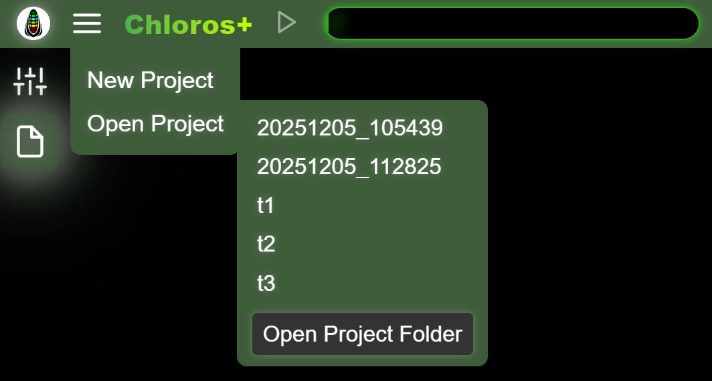

# GUI: Prosjekter

Chloros lar deg opprette prosjekter som kan åpnes på nytt senere.

## Nytt prosjekt

<figure><figcaption></figcaption></figure>Velg «Nytt prosjekt» fra hovedmenyen og skriv inn et unikt navn for prosjektet ditt.

## Åpne prosjekt

<figure><figcaption></figcaption></figure>Velg «Åpne prosjekt» for å se en liste over eksisterende prosjekter i prosjektmappen. Hvis det ikke finnes noen prosjekter, åpnes ikke den sekundære sidemenyen. Du kan se noen GUI-opprettede prosjekter (t1, t2, t3) oppført på bildet ovenfor. DATE\_TIME-prosjektene ble opprettet av CLI ved hjelp av standardnavngivningsskjemaet for prosjekter. Hvis du klikker på et prosjektnavn, åpnes det.

Hvis du klikker på «Åpne prosjektmappe»-knappen, åpnes filutforskeren på datamaskinen din i prosjektbanen. Du kan justere prosjektbanen i [Prosjektinnstillinger](project-settings/project-settings.md).

## Legg til filer

Når et prosjekt er åpnet, velger du «Legg til filer» fra hovedmenyen for å legge til enkeltbildefiler til det aktuelle prosjektet. Dette speiler filutforskerens funksjonalitet for å legge til filer, men er tilgjengelig direkte fra hovedmenyen for enkelhets skyld.

## Legg til mappe

Når et prosjekt er åpnet, velger du «Legg til mappe» fra hovedmenyen for å legge til en hel mappe med bilder til det aktuelle prosjektet. Dupliserte filer ignoreres.

## Start / Stopp behandling

Når filer er lagt til et prosjekt, blir «Start behandling» tilgjengelig i hovedmenyen. Dette er den samme handlingen som å klikke på Spill av/Start-knappen i toppmenyen. Under behandlingen endres menyelementet til «Stopp behandling» for å la deg stoppe behandlingskjeden.


Menyvalgene Legg til filer, Legg til mappe og Start/Stopp behandling er kun synlige eller aktive når et prosjekt er åpent og filer er lagt til. De gir rask tilgang til handlinger som også er tilgjengelige via filbrowsersidepanelet og knappene i toppmenyen.

